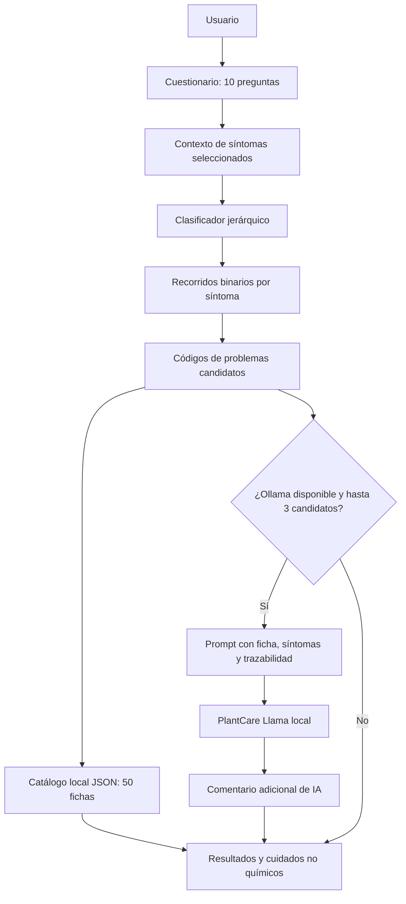

<div align="center">

# 🌿 PlantCare Tree

**Sistema de orientación para el diagnóstico de problemas en plantas mediante árboles binarios de decisión e inteligencia artificial local.**


*Proyecto académico de Estructuras de Datos No Lineales.*

</div>

---

##  Descripción

**PlantCare Tree** es una aplicación de escritorio desarrollada en Python que ayuda a identificar **posibles problemas en plantas** a partir de síntomas observados por el usuario.

El núcleo de clasificación utiliza un **árbol binario jerárquico**. La aplicación recoge las respuestas mediante un cuestionario visual, recorre el árbol y presenta las fichas correspondientes a los problemas candidatos. De forma complementaria, puede solicitar a un modelo local de **Llama 3.2 1B**, ejecutado con **Ollama**, explicaciones contextualizadas sobre los resultados.

La clasificación está basada en reglas y el contenido es **orientativo**: los códigos obtenidos no representan diagnósticos botánicos confirmados.

### Características principales

- **10 preguntas** organizadas por categorías de síntomas, con **5 opciones por pregunta** y selección múltiple.
- **50 síntomas identificables** (`sign_001` a `sign_050`) asociados a **50 fichas de problemas** (`PC-001` a `PC-050`).
- Árbol binario con **49 nodos de decisión**, **50 hojas diagnósticas** y **profundidad máxima de 7 decisiones**.
- Recorrido independiente del árbol por cada síntoma seleccionado, conservando varios problemas candidatos cuando corresponde.
- Fichas con síntomas de referencia y recomendaciones de **manejo orgánico o no químico**.
- Explicaciones opcionales con **PlantCare AI**, utilizando el problema detectado, las observaciones y su recorrido en el árbol.
- Funcionamiento del diagnóstico **sin Ollama**: las fichas originales del catálogo permanecen disponibles.
- Prueba complementaria de consulta a un archivo **TXT de 50 respuestas**, con comparación literal y recuperación segura del texto original.
- **155 pruebas automatizadas aprobadas** en la verificación de octubre de 2026.

## Tecnologías

| Tecnología | Función |
|---|---|
| **Python ≥ 3.11** | Lógica de la aplicación y estructuras de datos |
| **CustomTkinter** | Interfaz gráfica de escritorio |
| **Pillow** | Soporte para recursos gráficos |
| **JSON** | Cuestionario, reglas del árbol, catálogo y casos de prueba |
| **Ollama** | Ejecución local del modelo de lenguaje |
| **Llama 3.2 1B** | Generación opcional de explicaciones |
| **pytest** | Pruebas unitarias y de integración |
| **Git / GitHub** | Control de versiones |

## Arquitectura y funcionamiento



**Separación de responsabilidades:**

1. **Cuestionario:** registra las observaciones y permite avanzar, volver y seleccionar varios síntomas.
2. **Árbol binario:** decide qué códigos corresponden a los síntomas reportados. Cada síntoma positivo se evalúa mediante un recorrido binario independiente; los resultados se reúnen sin descartar los demás.
3. **Catálogo:** proporciona la información de referencia sobre síntomas y manejo no químico. **No depende de Llama**.
4. **IA local:** recibe únicamente las fichas y el contexto pertinente para redactar una explicación adicional. No es responsable de escoger o reemplazar los códigos del árbol.

> **Nota técnica:** las 10 preguntas de la interfaz no son los 10 niveles del árbol. Son dos conceptos distintos. El árbol activo tiene una profundidad máxima de 7 decisiones binarias.

## Estructura del proyecto

```text
PlantCare-Tree/
├── assets/
│   └── images/symptoms/             # Recursos gráficos del cuestionario
├── data/
│   ├── PlantCareTree_hierarchical.json  # Árbol binario activo
│   ├── diagnostic_group_conditions.json # Condiciones de las ramas
│   ├── questionnaire_50_draft.json      # 10 preguntas y 50 síntomas
│   ├── plant_problems.json              # Catálogo de 50 fichas
│   ├── plantcare_respuestas_referencia.txt # Referencias para demo TXT
│   ├── augmented_test_cases.json        # 151 casos sintéticos de regresión
│   └── PlantCareTree.json               # Árbol anterior, conservado
├── scripts/
│   ├── generate_augmented_cases.py
│   └── probar_txt_ollama.py
├── src/
│   └── plantcare/
│       ├── ai/                       # Prompts, cliente Ollama y TXT
│       ├── diagnosis/                # Clasificador, contexto y catálogo
│       ├── tree/                     # Nodos y recorrido del árbol binario
│       └── ui/                       # Interfaz CustomTkinter
├── tests/                            # Pruebas unitarias y de integración
├── main.py                           # Punto de entrada
├── Modelfile                         # Personalización de PlantCare Llama
├── pyproject.toml                    # Metadatos y dependencias
└── README.md
```

*El archivo `PlantCareTree_hierarchical.json` es el árbol utilizado por la interfaz actual; `PlantCareTree.json` se conserva como referencia de una versión anterior.*

## Instalación en Windows

### 1. Requisitos

- Windows con Python **3.11 o superior** instalado y disponible desde PowerShell.
- Git, para clonar el repositorio.
- Ollama y el modelo Llama 3.2 1B **solo si deseas activar los comentarios de IA**.
- Conexión a Internet para la instalación inicial de dependencias y descarga del modelo.

### 2. Obtener el proyecto

> Estas instrucciones corresponden a la versión actual del proyecto. Para reproducirla desde GitHub, primero debe haberse publicado la rama o integración que contiene estas funcionalidades.

```powershell
git clone https://github.com/Rinmontaki/PlantCare-Tree.git
cd PlantCare-Tree
```

### 3. Crear y activar un entorno virtual

```powershell
python -m venv .venv
.\.venv\Scripts\Activate.ps1
```

Si PowerShell bloquea temporalmente la activación de scripts, puedes utilizar el intérprete sin activar el entorno:

```powershell
.\.venv\Scripts\python.exe -m pip install -e ".[dev]"
.\.venv\Scripts\python.exe main.py
```

### 4. Instalar dependencias

Con el entorno virtual activado:

```powershell
python -m pip install --upgrade pip
python -m pip install -e ".[dev]"
```

El paquete incluye las dependencias de la interfaz; la opción `dev` instala además `pytest`.

### 5. Ejecutar la aplicación

```powershell
python main.py
```

Se abrirá el cuestionario gráfico. **El diagnóstico basado en el árbol y las fichas del catálogo pueden utilizarse sin Ollama**; en ese caso no se generarán comentarios adicionales de IA.

## Configurar PlantCare AI con Ollama

La aplicación se comunica con Ollama mediante su API local (`http://127.0.0.1:11434`) y solicita, de forma predeterminada, el modelo **`plantcare-llama:latest`**.

1. Instala [Ollama](https://ollama.com/) en tu equipo y ábrelo.
2. Desde PowerShell, en la carpeta del proyecto, ejecuta:

```powershell
ollama pull llama3.2:1b
ollama create plantcare-llama -f .\Modelfile
ollama list
```

3. Comprueba que aparezca `plantcare-llama:latest` en la lista.
4. Inicia PlantCare Tree:

```powershell
python main.py
```

El archivo `Modelfile` configura instrucciones para que Llama use el contexto recibido, no cambie los códigos diagnosticados y evite recomendaciones químicas. **Esto es personalización mediante instrucciones, no fine-tuning de los pesos del modelo.**

La interfaz solicita explicaciones automáticamente cuando hay **entre uno y tres problemas candidatos**. Con más de tres, conserva todas las fichas y omite el comentario automático por rendimiento.

## Ejemplos de uso

### Un problema candidato

Selecciona `sign_022` (manchas amarillas angulares y vello bajo la hoja) en la pregunta relacionada con manchas y mohos; responde «Ninguno de estos síntomas» en las demás.

**Resultado esperado:** `PC-022 — Mildiu velloso`, con síntomas y cuidados de referencia. Si Ollama está disponible, se añade un comentario separado.

### Varios problemas candidatos

Selecciona `sign_001` en la primera pregunta y `sign_050` en la décima, dejando las demás sin síntomas.

**Resultado esperado:** `PC-001 — Exceso de riego` y `PC-050 — Cochinilla radicular`, en dos fichas independientes. Esto comprueba que el clasificador no termina al encontrar el primer síntoma positivo.

### Sin síntomas

Marca «Ninguno de estos síntomas» en las diez preguntas.

**Resultado esperado:** aviso de **evidencia insuficiente**, sin inventar un problema candidato.

## Demostración adicional: conocimiento desde TXT

El archivo `data/plantcare_respuestas_referencia.txt` contiene **50 fichas derivadas del catálogo JSON**. Un script independiente recupera una ficha por código, la entrega a Llama cuando corresponde y compara la respuesta con el texto original.

```powershell
# Recuperación literal sin consultar a Llama
python -m scripts.probar_txt_ollama --code PC-022 --mode offline

# Simulación de respuesta incorrecta y recuperación segura
python -m scripts.probar_txt_ollama --code PC-050 --mode incorrect

# Consulta real a Ollama y comparación literal
python -m scripts.probar_txt_ollama --code PC-024 --mode live
```

**Interpretación:** el programa distingue si Llama reprodujo literalmente el contenido y, en cualquier caso, entrega como respuesta final el texto original del TXT. Por tanto, una respuesta modificada por el modelo no reemplaza el contenido de referencia.

Esta demostración **no forma parte del flujo principal de la interfaz**, que utiliza directamente `plant_problems.json`. Tampoco representa entrenamiento del modelo ni verificación botánica independiente: el TXT procede del mismo catálogo.

## Pruebas y calidad

Para ejecutar toda la suite:

```powershell
python -m pytest -q
```

**Último resultado registrado (21 de octubre de 2026):** `155 passed`.

Pruebas específicas:

```powershell
# Estructura y recorridos jerárquicos
python -m pytest -q tests/test_hierarchical_classifier.py

# Integración entre cuestionario y clasificador
python -m pytest -q tests/test_hierarchical_end_to_end.py

# Contexto aportado a Llama
python -m pytest -q tests/test_ai_case_context.py

# Recuperación de fichas desde TXT
python -m pytest -q tests/test_txt_knowledge.py
```

Los casos sintéticos del archivo `data/augmented_test_cases.json` se pueden volver a generar con:

```powershell
python -m scripts.generate_augmented_cases
```

El conjunto incluye **151 escenarios reproducibles** (uno sin síntomas y variaciones con uno, dos o tres síntomas). Se utiliza para **pruebas estructurales del clasificador**, no para entrenar a Llama ni medir precisión diagnóstica real. El total de **155 pruebas pytest** corresponde a la suite completa y **no** significa 155 consultas reales exitosas a la IA.

## Alcance y limitaciones

- PlantCare Tree es una **herramienta educativa de orientación**, no sustituye la evaluación de un especialista ni confirma enfermedades o plagas.
- Un mismo síntoma puede corresponder a distintas causas; el resultado depende de las opciones seleccionadas y de las reglas implementadas.
- Cuando aparecen varios códigos, son **candidatos asociados a observaciones**, no evidencia de que todos los problemas estén presentes simultáneamente.
- Los comentarios de Llama pueden contener errores. Su validación automática es **estructural** (por ejemplo, código y nombre del problema), no una comprobación científica exhaustiva.
- El catálogo de 50 fichas es una **base inicial de referencia**, pendiente de validación específica según especie, condiciones ambientales y fuentes técnicas adicionales.
- Las 151 variaciones de prueba son **datos sintéticos de regresión**; no constituyen casos botánicos confirmados ni un conjunto de *fine-tuning*.

## Solución de problemas

| Situación | Qué comprobar |
|---|---|
| `ModuleNotFoundError: plantcare` | Instala el proyecto con `python -m pip install -e ".[dev]"` desde su carpeta raíz. |
| `ModuleNotFoundError: customtkinter` | Reinstala las dependencias del proyecto en el entorno virtual activo. |
| `ollama list` no puede conectar | Abre Ollama y verifica que el servicio local esté iniciado. |
| No aparece `plantcare-llama` | Ejecuta `ollama pull llama3.2:1b` y `ollama create plantcare-llama -f .\Modelfile`. |
| Se muestra el diagnóstico, pero no el comentario de IA | Comprueba el servicio Ollama, el modelo y que no haya más de tres problemas candidatos. |
| La aplicación indica evidencia insuficiente | Verifica que hayas marcado al menos un síntoma positivo durante el cuestionario. |

## Autores

**Pablo Molina** y **David Gaviria**
Proyecto académico — **Estructuras de Datos No Lineales**.

---

<div align="center">

**PlantCare Tree** · Árboles binarios, conocimiento estructurado e IA local al servicio de una orientación botánica responsable.

</div>
